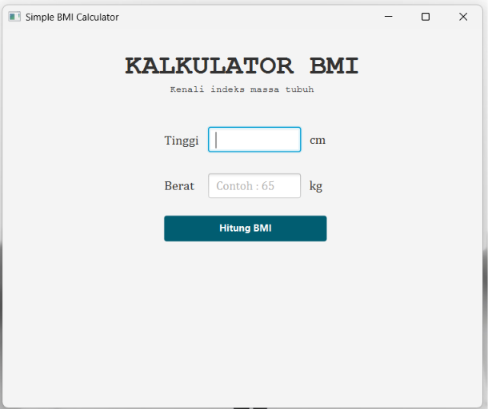
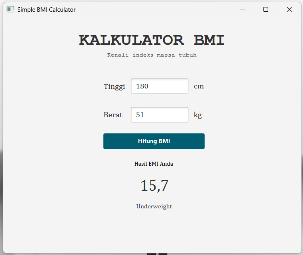
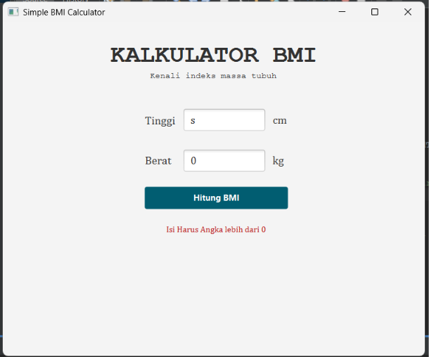
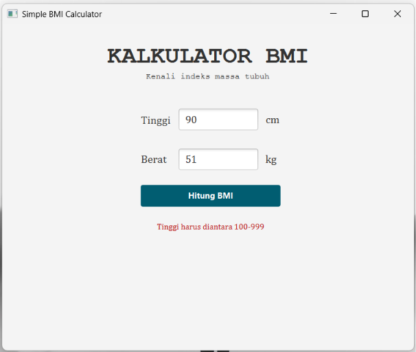
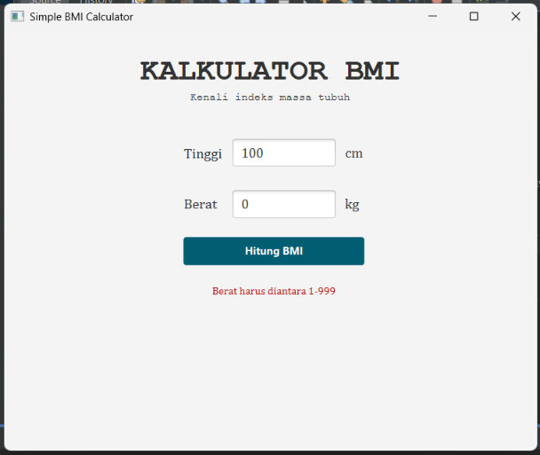

# BmiApps - BMI Calculator

Aplikasi kalkulator Indeks Massa Tubuh (Body Mass Index/BMI) berbasis JavaFX.

## Deskripsi

BmiApp merupakan aplikasi desktop sederhana untuk menghitung BMI berdasarkan berat badan dan tinggi badan pengguna. Aplikasi ini dibuat menggunakan Java, JavaFX, FXML, dan Maven.

## Tampilan Aplikasi  
Berikut contoh dari tampilan BMI Calculator

### 1. Tampilan Utama
  

### 2. Hasil Perhitungan BMI
  

### 3. Exception Handling
  
  


## Fitur

- Input berat badan dalam kilogram (kg).
- Input tinggi badan dalam sentimeter (cm).
- Perhitungan BMI secara otomatis.
- Tampilan hasil BMI dan indikator kategori.
- Validasi input dan Exception handling.

## Teknologi

- Java 26
- JavaFX 21
- FXML
- Maven
- NetBeans IDE

## Struktur Proyek

```text
BmiApp/
├── pom.xml
├── README.md
├── .gitignore
└── src/
    ├── main/
    │   ├── java/
    │   │   ├── controller/
    │   │   ├── main/
    │   │   └── model/
    │   └── resources/
    │       └── view/
    │           └── bmi-app.fxml
    └── test/
        └── java/
```

## Persyaratan

- JDK 26 atau versi yang kompatibel dengan konfigurasi proyek.
- Maven.
- JavaFX yang dikelola melalui dependensi Maven.

## Cara Menjalankan

1. Clone repositori.
2. Buka folder proyek di NetBeans atau IDE yang mendukung Maven.
3. Pastikan JDK yang digunakan sesuai dengan konfigurasi proyek.
4. Tunggu Maven mengunduh dependensi yang diperlukan.
5. Jalankan aplikasi menggunakan Maven

## Rumus BMI

- BMI dihitung menggunakan rumus:

  BMI = berat badan (kg) / [tinggi badan (m)]²  
  
  Tinggi badan dalam sentimeter dikonversi menjadi meter sebelum perhitungan dilakukan.

- Indikator Kategori : 

  Underweight	< 18,5  

  Normal	18,5 – 22,9  

  Overweight	23 – 24,9  

  Obesitas I	25 – 29,9  

  Obesitas II	≥ 30

## Lisensi

Belum ditentukan.
